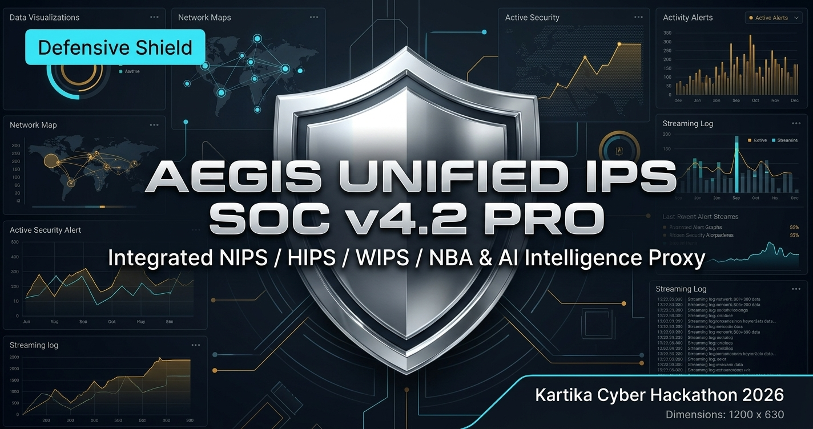

AEGIS UNIFIED IPS SOC v4.2 PRO

Cybersecurity Unified IPS SOC Dashboard featuring integrated NIPS, HIPS, WIPS, NBA prevention engines, and AI Intelligence Proxy topology powered by Groq LPU (Threat Agent & Copilot Agent).

Kategori 02: Defensive Shield — Kartika Cyber Hackathon 2026
](https://aegis-ips-soc.onrender.com/)


---

Panduan Deploy Live ke Production (GitHub & Render / Vercel)

Aplikasi ini adalah Full-Stack Application (React SPA + Express API Backend).
Opsi deployment yang paling direkomendasikan & paling stabil adalah Render (Web Service) karena mendukung server Node.js/Express secara terus menerus (persistent process).

---

Langkah 1: Push Proyek ke GitHub

1. Buat repository baru di [GitHub](https://github.com/new) (misalnya: `aegis-ips-soc`).
2. Di terminal komputer Anda, jalankan:
   ```bash
   # Ganti URL di bawah dengan URL repository GitHub Anda
   git remote add origin https://github.com/USERNAME/aegis-ips-soc.git
   git branch -M main
   git push -u origin main
   ```

---

Langkah 2: Deploy ke RENDER (Direkomendasikan ★★★★★)

Render adalah platform terbaik untuk aplikasi Express + Vite ini.

1. Buka dashboard [Render](https://dashboard.render.com/) dan login.
2. Klik tombol New + &rarr; Pilih Web Service.
3. Pilih repository GitHub Anda (`aegis-ips-soc`).
4. Atur konfigurasi berikut:
   - Name: `aegis-ips-soc`
   - Region: Singapore (atau terdekat)
   - Branch: `main`
   - Runtime: `Node`
   - Build Command: `npm install && npm run build`
   - Start Command: `npm start`
   - Instance Type: `Free`
5. Buka tab Environment Variables di Render dan tambahkan:
   - `NODE_ENV`: `production`
   - `GROQ_THREAT_API_KEY`: `YOUR_GROQ_THREAT_KEY_HERE`
   - `GROQ_COPILOT_API_KEY`: `YOUR_GROQ_COPILOT_KEY_HERE`
   - `GROQ_MODEL`: `qwen/qwen3.8-27b`
6. Klik Create Web Service. Dalam 1–2 menit, aplikasi Anda akan LIVE dengan URL publik HTTPS gratis (misal: `https://aegis-ips-soc.onrender.com`).

---

Langkah 3 (Alternatif): Deploy ke VERCEL

Jika Anda lebih memilih Vercel:

1. Buka dashboard [Vercel](https://vercel.com/) dan login dengan GitHub.
2. Klik Add New... &rarr; Project.
3. Import repository `aegis-ips-soc`.
4. Konfigurasi project:
   - Framework Preset: `Vite`
   - Build Command: `npm run build`
   - Output Directory: `dist`
5. Di bagian Environment Variables, tambahkan:
   - `GROQ_THREAT_API_KEY`: `YOUR_GROQ_THREAT_KEY_HERE`
   - `GROQ_COPILOT_API_KEY`: `YOUR_GROQ_COPILOT_KEY_HERE`
   - `GROQ_MODEL`: `qwen/qwen3.8-27b`
6. Klik Deploy.

---

Menjalankan di Lokal (Development)

```bash
# 1. Install dependensi
npm install

# 2. Jalankan server dev (Express + Vite)
npm run dev

# 3. Buka browser di http://localhost:3000
```
